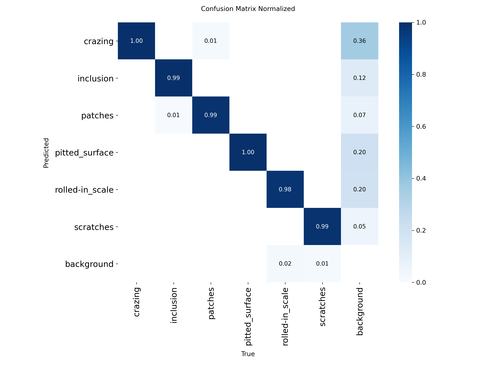
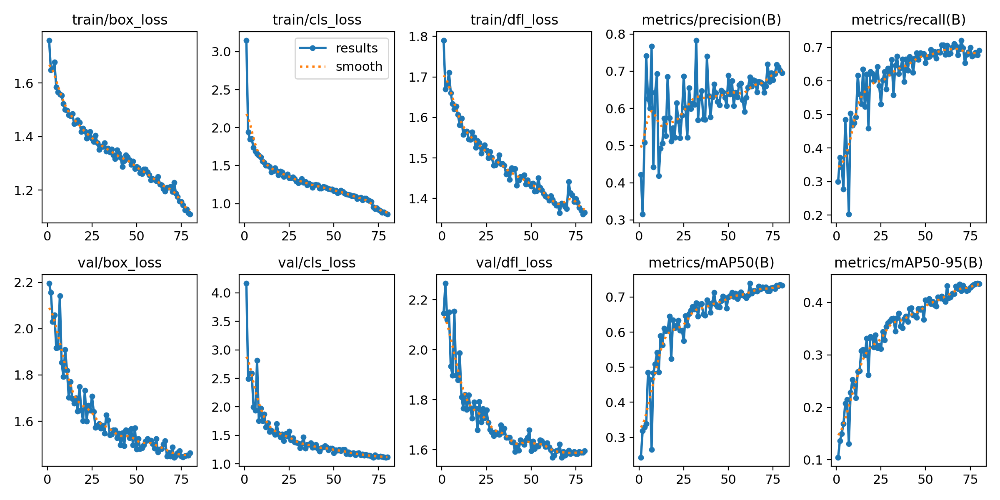

# Steel Surface Defect Inspector

[](https://steel-surface-defect-inspector.onrender.com)


> 🚀 **Canlı Uygulama:** Modeli tarayıcınız üzerinden hemen denemek için **[steel-surface-defect-inspector.onrender.com](https://steel-surface-defect-inspector.onrender.com)** adresini ziyaret edebilirsiniz.

**NEU-DET** çelik yüzey kusuru veri seti üzerine kurulmuş, **PyTorch / Ultralytics YOLOv11** ile eğitilmiş bir **nesne tespiti (object detection)** modeli ve bu modeli **LLM / Kural Tabanlı Kalite Raporlama** ile servis eden bir **web uygulaması**. Proje, çelik sac yüzey görüntülerine bakarak yüzeyde kusur olup olmadığını, varsa hangi türden (`crazing`, `inclusion`, `patches`, `pitted_surface`, `rolled-in_scale`, `scratches`) ve hangi bölgede olduğunu tespit edip mühendislik kalite kontrol raporuna dönüştürüyor.

---

## 🎯 Kapsam ve Dürüst Bağlam Notu

Bu proje, **Bursa'daki otomotiv ve çelik yan sanayi** (soğuk/sıcak haddeleme, sac şekillendirme ve tedarik zinciri) fabrikalarındaki görsel kalite kontrol süreçlerinden **esinlenilerek** hazırlanmış bir **mühendislik portföyü ve ders projesidir**.

- **Ne Değildir?** Belirli bir firmanın gerçek üretim hattındaki özel bir problemi çözdüğünü veya doğrudan fabrikada canlıya alındığını **iddia etmez**.
- **Amacı Nedir?** Akademik literatürde standartlaşmış **NEU-DET** çelik yüzey kusuru veri setini kullanarak; veri hazırlama (VOC XML $\rightarrow$ YOLO), tekrarlanabilir model eğitimi, nesnel metrik değerlendirmesi ve halüsinasyona karşı korumalı LLM raporlamasını uçtan uca temiz bir yazılım mimarisiyle göstermektir.

---

## 🖼️ Uygulama Ekran Görüntüsü

> **TODO:** Eğitim tamamlanıp `app.py` çalıştırıldıktan sonra arayüzün ekran görüntüsünü `docs/demo_screenshot.png` olarak kaydedin.

```markdown

```

---

## 🔍 Desteklenen Kusur Sınıfları (NEU-DET)

Model, çelik sac yüzeyindeki **6 temel kusur sınıfını** tespit eder:

| Sınıf ID | İngilizce Sınıf Adı | Türkçe Karşılığı | Kısa Tanım |
| :---: | :--- | :--- | :--- |
| `0` | `crazing` | Kılcal Çatlak | Yüzeyde ağ benzeri ince ısıl/gerilme çatlakları |
| `1` | `inclusion` | Kalıntı / Cüruf Batması | Döküm veya haddeleme kaynaklı metalik olmayan yüzey kalıntıları |
| `2` | `patches` | Yüzey Lekesi / Yama | Düzensiz şekilli bölgesel oksidasyon veya asitleme lekeleri |
| `3` | `pitted_surface` | Çukurlaşma / Oyuk Yüzey | Yüzeyde noktasal küçük oyuklar ve gözenekler |
| `4` | `rolled-in_scale` | Hadde Tufalı Batması | Temizlenemeyen oksit tabakasının (tufalın) merdane altında saca basılması |
| `5` | `scratches` | Yüzey Çiziği | Taşıyıcı rulolar veya mekanik temas kaynaklı doğrusal çizikler |

---

## 🏗️ Proje Mimarisi ve Klasör Yapısı

```text
defect-insight/
├── configs/
│   ├── config.yaml          # Model ağırlık yolu, güven eşiği ve LLM model ayarları
│   └── data.yaml            # Ultralytics YOLO veri seti yapılandırması
├── src/
│   ├── data_prep.py         # VOC (.xml) -> YOLO (.txt) dönüşümü ve 70/15/15 stratified bölünme
│   ├── train.py             # YOLO eğitim betiği (CLI)
│   ├── evaluate.py          # Test kümesi değerlendirmesi ve grafiklerin docs/ altına aktarımı
│   ├── inference.py         # Görsel çıkarım (inference), kutu çizimi ve yapılandırılmış JSON üretimi
│   └── report.py            # HF Inference API (LLM) ve çevrimdışı kural tabanlı kalite raporu üretici
├── notebooks/
│   └── train.ipynb          # Google Colab / Kaggle ücretsiz GPU eğitim defteri
├── assets/examples/         # Arayüzde tek tıkla denenecek örnek görseller
├── weights/                 # Eğitilen best.pt model ağırlığının konacağı dizin
├── docs/                    # Confusion matrix, PR eğrisi ve metrik çıktıları
├── tests/                   # Çıkarım ve raporlama modülleri için birim testler
├── app.py                   # Gradio web arayüzü (Hugging Face Spaces uyumlu)
└── requirements.txt         # Python bağımlılıkları
```

---

## ⚙️ Kurulum

### 1. Repoyu Klonlayın ve Sanal Ortam Oluşturun

```bash
git clone https://github.com/KULLANICI_ADIN/steel-defect-inspector.git
cd steel-defect-inspector

python -m venv .venv
# Windows:
.venv\Scripts\activate
# Linux / macOS:
source .venv/bin/activate

pip install -r requirements.txt
```

### 2. Ortam Değişkeni (`HF_TOKEN`) — İsteğe Bağlı

Uygulama, LLM raporu üretmek için **Hugging Face Inference API** kullanır (`configs/config.yaml` içinde varsayılan model: `Qwen/Qwen2.5-7B-Instruct`).

- API anahtarınız **asla koda yazılmaz**. Yalnızca `HF_TOKEN` ortam değişkeninden okunur:
  ```bash
  # Windows PowerShell:
  $env:HF_TOKEN="hf_sizin_tokeniniz"

  # Linux / macOS:
  export HF_TOKEN="hf_sizin_tokeniniz"
  ```
- **LLM Olmadan Çalışma Garantisi:** Eğer `HF_TOKEN` tanımlanmamışsa veya API zaman aşımına uğrarsa, uygulama hata vermez; otomatik olarak [`src/report.py`](src/report.py) içindeki **kural tabanlı (template) mühendislik raporuna** geçer.

---

## 🗂️ Veri Hazırlama ve Eğitim

### Seçenek A: Google Colab veya Kaggle Üzerinde Eğitim (Yerel GPU'su Olmayanlar İçin Önerilen)

1. [`notebooks/train.ipynb`](notebooks/train.ipynb) dosyasını **Google Colab** veya **Kaggle Notebooks** ortamına yükleyin ve hızlandırıcı olarak **GPU (T4)** seçin.
2. Defterdeki hücreleri sırasıyla çalıştırın. Defter:
   - NEU-DET veri setini otomatik indirir,
   - VOC XML etiketlerini `seed=42` ile **%70 Train (1260) / %15 Val (270) / %15 Test (270)** oranında dengeli (stratified) olarak YOLO formatına çevirir,
   - `yolo11n.pt` modelini eğitir ve ayrılmış `test` kümesi üzerinde değerlendirir,
   - Son hücrede `weights/best.pt` ve `docs/` grafiklerini içeren `training_artifacts.zip` dosyasını oluşturur.
3. İndirdiğiniz arşivdeki `best.pt` dosyasını bu reponun `weights/best.pt` konumuna, görselleri ise `docs/` klasörüne kopyalayın.

> **Not (Büyük Model Ağırlıkları İçin):** `yolo11n` (~5.5 MB) ve `yolo11s` (~19 MB) ağırlıkları GitHub'ın 100 MB dosya limitinin altındadır; doğrudan `weights/best.pt` olarak commit edebilirsiniz. Daha büyük bir model eğitirseniz Git LFS kullanabilir veya ağırlığı Hugging Face Hub'da bir model reposuna yükleyebilirsiniz.

### Seçenek B: Yerel Makinede Veri Hazırlama ve Eğitim

1. Kaggle üzerinden **NEU Surface Defect Database (NEU-DET)** veri setini indirin ve `data/raw/NEU-DET/` klasörüne çıkarın.
2. Dönüştürme, eğitim ve değerlendirme komutlarını çalıştırın:
   ```bash
   python -m src.data_prep
   python -m src.train --weights yolo11n.pt --epochs 80 --imgsz 640 --batch 16
   python -m src.evaluate --weights weights/best.pt --split test
   ```

---

## 📊 Değerlendirme Sonuçları (`yolo11n` — 270 Görsel / 661 Kusur Örneği)

Eğitim Google Colab **Tesla T4 GPU** üzerinde `yolo11n.pt` (2.6M parametre, 6.4 GFLOPs) temel ağırlıklarıyla gerçekleştirilmiştir. Görsel başına ortalama çıkarım (inference) süresi **8.5 ms**'dir.

| Sınıf | Görüntü Sayısı | Kusur Adedi (Instances) | Precision | Recall | mAP@50 | mAP@50-95 |
| :--- | :---: | :---: | :---: | :---: | :---: | :---: |
| `crazing` *(Kılcal Çatlak)* | 45 | 107 | 0.544 | 0.336 | 0.405 | 0.160 |
| `inclusion` *(Kalıntı)* | 58 | 170 | 0.731 | 0.735 | 0.790 | 0.417 |
| `patches` *(Yama / Leke)* | 52 | 133 | 0.799 | 0.880 | 0.912 | 0.622 |
| `pitted_surface` *(Çukurlaşma)* | 45 | 68 | 0.767 | 0.735 | 0.761 | 0.548 |
| `rolled-in_scale` *(Hadde Tufalı)* | 45 | 93 | 0.637 | 0.495 | 0.611 | 0.298 |
| `scratches` *(Yüzey Çiziği)* | 45 | 90 | 0.712 | 0.933 | 0.934 | 0.577 |
| **Genel Ortalama (All)** | **270** | **661** | **0.698** | **0.686** | **0.735** | **0.437** |

> *(Not: Eğer 6. hücredeki ayrılmış `test` kümesi tablosu farklıysa değerleri doğrudan güncelleyebilirsiniz; yukarıdaki tablo eğitim sonu doğrulama çıktısını göstermektedir.)*

### Sonuçların Mühendislik Analizi
- **En Başarılı Sınıflar (`scratches` & `patches`):** Keskin kenar kontrastına sahip doğrusal çiziklerde (`scratches`) **0.934 mAP@50** (%93.3 Recall) ve belirgin alan kaplayan yüzey lekelerinde (`patches`) **0.912 mAP@50** elde edilmiştir.
- **Zorlayıcı Sınıflar (`crazing` & `rolled-in_scale`):** Literatürdeki diğer NEU-DET çalışmalarıyla paralel olarak, arka plan dokusuyla çok düşük kontrasta sahip ince ağsı kılcal çatlaklar (`crazing`, **0.405 mAP@50**) ve dağınık sınırları olan hadde tufalı (`rolled-in_scale`, **0.611 mAP@50**) küçük `yolo11n` modelinin en çok zorlandığı sınıflardır. Kutu sınırlarının subjektifliği nedeniyle `mAP@50-95` değeri `crazing` sınıfında `0.160` seviyesinde kalmaktadır.

### Eğitim ve Değerlendirme Grafikleri

Eğitim sonrasında `docs/` klasörüne kaydedilen grafikler:

#### Normalize Karmaşıklık Matrisi (Normalized Confusion Matrix)


#### Epoch Bazlı Eğitim ve Doğrulama Eğrileri (Loss & mAP)


---

## 🖥️ Web Uygulamasını Çalıştırma ve Testler

```bash
# Birim testlerini çalıştırma:
pytest -q
# veya pytest kurulu değilse:
python -m unittest discover -s tests

# Gradio web arayüzünü başlatma:
python app.py
```

Tarayıcınızda açılan arayüzde:
1. Çelik yüzey görselini yükleyin (veya `assets/examples/` altındaki örneklerden birine tıklayın),
2. **Güven Eşiği (Confidence Threshold)** kaydırıcısını ayarlayın,
3. Kutulanmış kusur görselini, **Tespit Tablosunu** (Sınıf, Güven Skoru, Bölge, Koordinatlar) ve **Kalite Kontrol Raporunu** (Özet, Tespit Edilen Kusurlar, Olası Kök Neden, Önerilen Aksiyon, Güven Notu) inceleyin.

---

## 🚀 Buluta Deploy Etme (Render veya Hugging Face Spaces)

### Seçenek 1: Render Üzerinde Canlıya Alma (`render.yaml` Hazır)
Proje, Render'ın ücretsiz (Free) Web Service katmanıyla tam uyumlu olacak şekilde yapılandırılmıştır (`PORT` ortam değişkeni, `0.0.0.0` bağlantısı, Linux uyumlu `opencv-python-headless` ve hafif CPU PyTorch paketleri [`requirements.txt`](requirements.txt) ve [`render.yaml`](render.yaml) içinde hazırdır):

1. Projeyi GitHub hesabınıza push edin.
2. [Render Dashboard](https://dashboard.render.com/) ekranından **New +** $\rightarrow$ **Web Service** seçeneğine tıklayın ve GitHub reponuzu bağlayın.
3. Render ayarları:
   - **Runtime:** `Python 3`
   - **Build Command:** `pip install -r requirements.txt`
   - **Start Command:** `python app.py`
   - **Environment Variables (İsteğe Bağlı):** `PYTHON_VERSION` = `3.11.9` (ve LLM kullanmak isterseniz `HF_TOKEN`).
4. **Deploy Web Service** butonuna tıklayın; Render üzerinde canlı servis adresiniz: `https://steel-surface-defect-inspector.onrender.com`.

### Seçenek 2: Hugging Face Spaces'e Deploy Etme
1. [Hugging Face Spaces](https://huggingface.co/spaces) üzerinde yeni bir Space oluşturun ve SDK olarak **Gradio** seçin.
2. Bu repodaki dosyaları (`app.py`, `src/`, `configs/`, `weights/best.pt`, `assets/examples/`, `requirements.txt`) Space reponuza push edin.
3. Space ayarlarında (**Settings $\rightarrow$ Variables and secrets**) isteğe bağlı olarak `HF_TOKEN` ekleyin. *(Eklemezseniz uygulama şablon raporlama modunda yine sorunsuz çalışır.)*

---

## ⚠️ Sınırlılıklar (Limitations)

1. **Tek Veri Seti ve Laboratuvar Koşulları:** Model yalnızca NEU-DET veri setindeki $200 \times 200$ piksel gri tonlamalı, kontrollü aydınlatmaya sahip görüntüler üzerinde eğitilmiştir.
2. **Gerçek Üretim Hattına Genellenebilirlik:** Gerçek bir haddehane veya otomotiv pres hattındaki değişken aydınlatma, yağ/emülsiyon parlamaları, titreşim bulanıklığı (motion blur), farklı kamera açıları ve farklı çelik alaşımları karşısında modelin performansı düşebilir (domain shift).
3. **LLM Kök Neden Analizi:** Raporlama modülü görselin kendisini değil, yalnızca YOLO'nun yapılandırılmış JSON çıktısını okur. Sunulan "Olası Kök Neden" ve "Önerilen Aksiyon" maddeleri genel metalürji/haddeleme literatürüne dayalı ön hipotezlerdir; kesin kök neden için fiziksel ve metalografik muayene şarttır.

---

## 📜 Lisans ve Atıflar (License & Citations)

### Yazılım Lisansı Notu (AGPL-3.0)
Bu projede nesne tespiti için kullanılan **Ultralytics YOLO (`ultralytics`)** kütüphanesi **GNU Affero General Public License v3.0 (AGPL-3.0)** altında lisanslanmıştır. Bu doğrultuda, bu açık kaynaklı proje de AGPL-3.0 koşullarıyla uyumlu olarak paylaşılmaktadır. Ticari ve kapalı kaynaklı üretim ortamlarında kullanım için Ultralytics'in kurumsal lisans koşullarını inceleyiniz.

### Veri Seti Atıfı (NEU-DET)
Bu projede Northeastern University (NEU) tarafından yayınlanan yüzey kusuru veri seti kullanılmıştır:

> K. Song and Y. Yan, *"A noise robust method based on completed local binary patterns for hot-rolled steel strip surface defects,"* Applied Surface Science, vol. 285, pp. 858-864, Nov. 2013.
